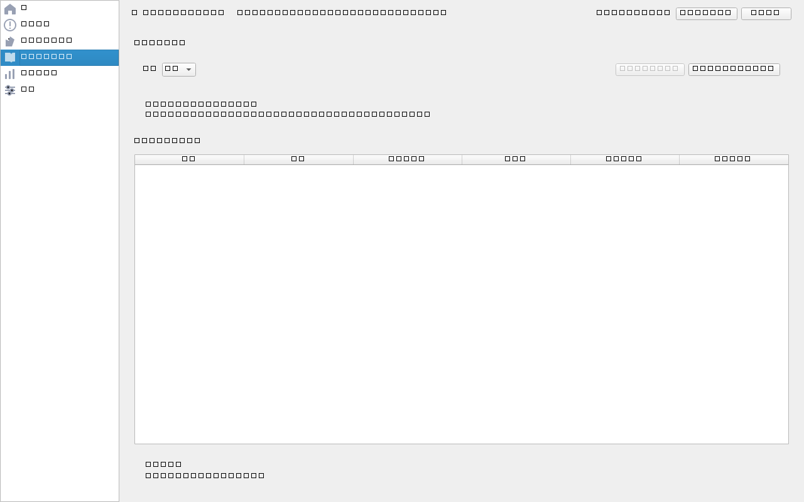

# chess-brain

**"내가 왜 이 수를 뒀나"를 다시 보는 대신, 같은 실수를 다시 안 하게 만드는 훈련 앱.**


Windows에서 더블클릭으로 실행된다. 설치도, 로그인도, 결제도 없다. 내 대국은 내 폴더에, 기록은 SQLite에, 분석은 로컬 Stockfish에서 돌아간다.



---

## 이 앱은 이런 걸 한다

1. 내가 둔 대국을 읽는다.
2. Stockfish로 내 수 하나하나의 손실을 잰다.
3. 손실이 큰 수만 골라 **테마를 붙이고 왜 틀렸는지 설명**한다.
4. 약한 테마에서 문제를 골라 푼다. 맞히면 간격을 늘리고, 틀리면 10분 뒤에 다시 만난다.

많이 푸는 게 목적이 아니다. **잊기 직전에 다시 만나는 것**이 목적이라 SM-2 변형으로 간격을 정한다.

## v0.2.4에서 뭐가 달라졌나

| 예전 | 지금 |
| --- | --- |
| 실수 12,240개가 그냥 세로로 나열됨 | 11개 테마로 분류해서 약한 것부터 추천 |
| "이 수가 왜 나쁜지" 없음 | 카드마다 사람 말로 쓴 해설. 정답 뒤에 바로 나옴 |
| 이미 99점 지고 끝난 국면도 카드로 나옴 | 진 국면 1,714개를 복습에서 제외. DB는 그대로 보관 |
| 봇은 최근 7일만 가져옴 | 사람이든 봇이든 **몇 판을 두든 과거 전부** 가져옴 |
| 앱 아이콘 없음 | 로고 SVG + 창 아이콘 |
| 3.14로 빌드 | 3.15.2로 빌드, 셀프테스트 통과 |

"바꿨다"고만 하면 알 수 없으니 숫자와 동작으로 적었다.

## 커리큘럼이 뭐가 다른가

테마는 엔진 원자료에서 자동으로 붙는다. 메이트 놓침, 메이트 당함, 백 랭크, 기물 걸림, 잡을 수 놓침, 포크·더블어택, 핀·묶임, 오프닝 판단, 엔드게임, 위치 판단, 전술 미스.

예를 들면 이런 해설이 붙는다.

> `Rg4`을 두면 상대가 `Rxd4`로 룩을 잡습니다. `Rfd1`가 정답입니다.

복습 다이얼로그에는 테마와 해설이 함께 나온다. 정답을 맞히거나 "모르겠음"을 누른 뒤에 읽게 된다.

커리큘럼 화면에서는 테마별 실수 수, 지금 복습할 개수, 정답률, 최근 4주 재발을 본다. 정답률이 낮은 테마에서 주로 뽑되 다른 테마도 섞어서 오늘의 10문제를 만든다. 테마를 직접 골라 집중 훈련도 할 수 있다.

이미 4점 이상 지고 있거나 메이트당하기 직전인 국면은 카드에서 빠진다. 거기선 무슨 수를 둬도 결과가 갈라지지 않아서 외울 게 없기 때문이다. `mistakes.skip_lost_positions`를 `false`로 바꾸면 이 필터를 끌 수 있다.

## 5분만에 시작하기

### exe

[릴리스 페이지](https://github.com/spidychoipro/chess-brain/releases)에서 zip을 받아 풀고 `chess-brain.exe`를 더블클릭하면 끝난다.

zip에는 `chess-brain.exe`, `_internal\`, `engines\`만 있다. 내 `config\`와 `data\`는 zip에 안 들어간다. 예전 폴더에서 쓰던 두 폴더를 새 폴더로 옮기면 기록이 그대로 이어진다.

### 소스

```bash
pip install -r requirements.txt
python main.py
```

검증 환경: Python 3.15.2, Windows 11.

## 첫 화면에서 할 일

홈에 "처음 시작하기" 카드가 뜬다. PGN 폴더 지정 → Stockfish 경로 → 대국 가져오기, 세 개다.

- **Stockfish 경로**는 zip을 쓴다면 비워 두면 된다. 번들 엔진을 자동으로 찾는다.
- **chess.com 아이디**는 선택이다. 내 수 색을 판별할 때만 쓴다.
- 가져오기와 분석은 홈 버튼으로 바로 돌릴 수 있다. 분석 진행률은 퍼센트와 `지금/전체`로 나오고 중단도 된다.

## 여섯 화면

| 화면 | 뭐 하는 곳인가 |
| --- | --- |
| 홈 | 오늘 할 일, 요약 카드, 바로 시작 버튼 |
| 내 실수 | 실수 목록 + 보드. 등급·소스 필터, 국면 재현, 응수 확인 |
| 기보 트레이닝 | Recall(내가 둔 수 재현), Drill(복습), 기보 읽기 4단계 |
| 훈련 커리큘럼 | 테마별 상태, 약점 추천, 재발 추적 |
| 기록/통계 | 최근 30일 정답률, 자주 틀리는 실수. 사람전/봇전 분리 |
| 설정 | PGN 경로, 엔진, 업데이트, 백업, 로그 |

기보를 못 읽어도 된다. 보드에서 기물을 클릭해서 수를 두고, 틀리면 빨간 표시가 뜬다. 정답은 "모르겠음"을 눌렀을 때만 공개한다.

## 대국은 어디서 오나

앱은 결국 **로컬 폴더**를 읽는다. `Bot` / `Human` 하위폴더를 두면 자동으로 구분된다.

| 경로 | 필요한 것 |
| --- | --- |
| 로컬 PGN 폴더 (권장) | 폴더 지정만 하면 됨 |
| rclone | rclone 설치 + 원격 경로. 앱은 키를 안 가짐 |
| 구글드라이브 | 공유 링크 + API 키 또는 credentials.json |

chess.com 자동 수집도 켜져 있다. 앱을 켜면 먼저 안 받은 과거 게임을 훑는다. 사람 게임은 공개 아카이브 API, 봇 게임은 게임 아카이브에서 가져온다. **판 수는 요청 횟수에 영향을 주지 않는다.** 30판이든 300판이든 달 단위로 몰아서 받고, 이미 받은 게임은 `processed`로 걸러낸다. 브라우저도 한 번만 띄운다. 전체 수집 타임아웃은 3600초다.

실행 중에는 10분마다 최근 7일만 가볍게 확인한다. 수집 로그는 화면에 실시간으로 찍히고 `data\chesscom-sync.log`에도 남는다. 도구가 없거나 네트워크가 막혀도 로컬 PGN 스캔은 그대로 된다.

## 복습 규칙

| 상황 | 결과 |
| --- | --- |
| 맞힘 | 1일 → 6일 → ×ease 로 간격 증가 |
| 모르겠음으로 정답 확인 | 오답 처리, 10분 뒤 재복습. 따라 두는 연습은 일정 무변경 |
| 틀렸지만 안 봄 | 기록 없이 계속 시도 |
| 예약된 미래 문제 | 정규 복습에서 제외. 직접 고르면 연습만 함 |

## 0원, 오프라인 기본

| 것 | 비용 |
| --- | --- |
| Stockfish sf_19 (GPLv3, exe + 소스 동봉) | 0원 |
| SQLite / PGN / 로컬 드라이브 | 0원 |
| chess.com 공개 아카이브 | 0원 |
| PySide6 / python-chess | 0원 |
| GitHub 태그 조회 | 0원 |

유료 추론 API나 LLM은 안 쓴다. `tests/test_no_paid_services.py`가 소스에 과금 서비스 주소가 들어오면 테스트를 깨뜨린다.

인터넷은 **요청할 때만** 쓴다. 업데이트 확인 버튼, chess.com 수집, rclone 복사 세 곳뿐이다. 평소 학습과 분석은 전부 오프라인이다.

업데이트 확인은 현재 버전 `0.2.4`를 GitHub 태그와 비교한다. 새 버전이 있으면 릴리스 페이지를 알려주고, 최신이면 최신이라고 말한다. 네트워크가 막히면 실패했다고 정확히 알린다.

## 기록이 사라질까 봐 걱정된다면

사본은 두 군데에서 관리한다.

- 앱을 켤 때마다 `data\backups\`에 DB와 설정을 남기고 최근 5개를 유지한다.
- 빌드할 때는 `backups\build-<날짜>\`에 `config\`, `data\` 통째로 복사한다. 빌드가 실패해도 사본은 남는다.

설정의 **백업 폴더 열기**로 바로 열 수 있다. 복구는 가장 최신 파일을 원래 자리에 복사하면 끝이다. 스키마가 바뀌어도 기존 DB는 초기화하지 않고 컬럼을 추가한다.

## 직접 빌드할 때

```powershell
powershell -ExecutionPolicy Bypass -File .\fetch-stockfish.ps1   # 엔진 없을 때 한 번
powershell -ExecutionPolicy Bypass -File .\build.ps1
```

`fetch-stockfish.ps1`은 공식 sf_19 포터블 빌드를 받는다. `Copying.txt`(GPLv3)와 `src\`가 함께 와서 zip에 그대로 들어간다. `build.ps1`은 설정/DB를 백업하고, 빌드 뒤 되돌리고, 오프스크린 셀프테스트까지 돌린다.

3.15 환경에 패키지 설치가 막히면 기존 3.14 site-packages를 빌려 쓰는 처리가 들어 있다.

## 코드를 보려면

```
main.py                 진입점 (--selftest)
core/
  chesscom.py           chess.com 수집 도구 호출
  parser.py             python-chess로 내 수 추출
  engine.py             Stockfish 자동 감지, 손실/등급/응수
  curriculum.py         테마 분류, 해설, 추천, 재발 추적
  db.py / sr.py         SQLite + 간격 반복
  pipeline.py           가져오기 → 문제 생성 → 분석
  drive.py / rclone.py  선택적 드라이브 연결
  update.py / version.py  버전과 태그 조회
ui/
  main.py               사이드바 + 헤더
  theme.py              다크 테마, SVG 아이콘, 로고
  board.py              클릭으로 수 두는 보드
  widgets.py            복습 패널 (테마·해설 표시)
  tabs/                 home, mistakes, training, curriculum, stats, settings
assets/                 로고 SVG, 화면 캡처
tests/                  unittest 67개
docs/learning-upgrade.md  학습 규칙 변경 기록
```

검증: `python -m unittest discover -s tests -v` → 67개 통과.
